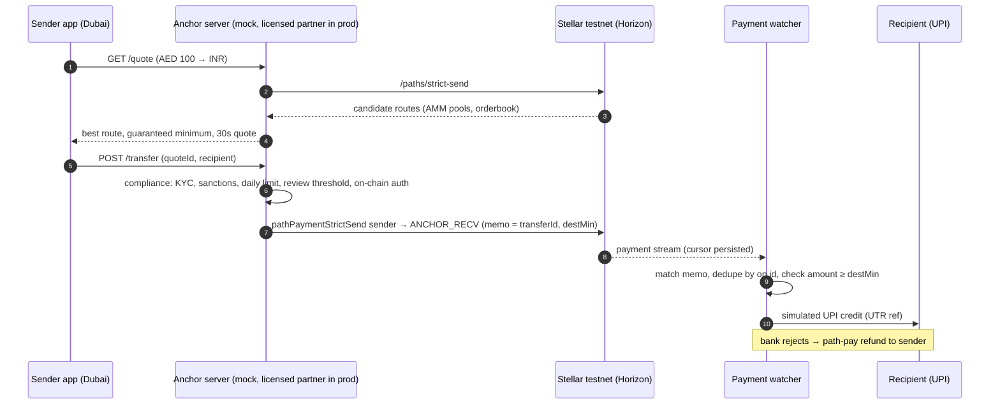

# RemitRail: compliant cross-border micro-settlement on Stellar

Migrant workers lose 6–8% of every remittance to correspondent-bank fees, FX markups and 1–5 day delays. RemitRail replaces that chain with a **Stellar path payment**: any of **11 currencies** goes in, any other comes out (**110 corridors**), atomically, in about 5 seconds, for **0.00001 XLM**. A mock payout anchor then credits the recipient on their local rail (UPI, ACH, SEPA Instant, Faster Payments, Zengin, Interac, NPP, PayNow, UAEFTS, GCash, SPEI).

## Corridors: every currency to every currency

| Currency | Country | Payout rail (mock) | Recipient details |
|---|---|---|---|
| USD | United States | ACH | ABA routing (checksum) + account |
| EUR | Eurozone | SEPA Instant | euro-area IBAN (mod-97) |
| GBP | United Kingdom | Faster Payments | sort code + 8-digit account |
| JPY | Japan | Zengin | bank code + branch code + 7-digit account |
| CAD | Canada | Interac e-Transfer | e-mail |
| AUD | Australia | NPP / Osko | BSB + account |
| SGD | Singapore | PayNow | +65 mobile |
| AED | United Arab Emirates | UAEFTS | UAE IBAN (mod-97) |
| INR | India | UPI or IMPS | UPI ID, or account + IFSC |
| PHP | Philippines | GCash | PH mobile |
| MXN | Mexico | SPEI | CLABE (checksum) |

**How any pair settles:** each currency is a `t<CUR>` asset with its own issuer, and has an AMM pool against `tUSDC` (hub and spoke). Stellar path finding routes any pair X → USDC → Y in **one atomic path payment**, and also considers direct orderbooks where they exist (AED ⇄ INR). A recipient's details must match the destination's rail (e.g. a USD payout to a UPI ID is rejected with `RECIPIENT_RAIL` before the quote is used).

**Adding a currency** is one row in `CURRENCY_LIST` in [shared/src/corridors.ts](shared/src/corridors.ts) (code, issuer, rail, fallback rate, pool depth), plus its issuer name in `ACCOUNT_NAMES` ([shared/src/constants.ts](shared/src/constants.ts)) and a bump of `BOOTSTRAP_VERSION`. Then `npm run bootstrap`: it creates the issuer, trustlines, float and pool. The UI, validation, FX and e2e pick it up automatically.

> **Prototype on Stellar testnet.** On-chain settlement, routing, asset authorization and clawback are real. Bank deposits, KYC and UPI payouts are simulated. No real money, no mainnet.

## What happens when you press Send



**Transfer state machine:** `CREATED → COMPLIANCE_CHECK → (BLOCKED | FLAGGED_FOR_REVIEW | APPROVED) → SUBMITTED → (ON_CHAIN_FAILED | SETTLED_ON_CHAIN) → PAYOUT_PENDING → (PAYOUT_COMPLETE | PAYOUT_FAILED → REFUND_PENDING → REFUNDED)`. Every transition is validated, persisted and streamed to the UI over SSE.

## Real vs mocked

| Real (Stellar testnet) | Mocked |
|---|---|
| Issued assets `tUSDC`, `tAED`, `tINR` with `AUTH_REQUIRED`, `AUTH_REVOCABLE`, `AUTH_CLAWBACK_ENABLED` | Fiat bank accounts and deposits |
| AMM pools (`tUSDC/tINR`, `tUSDC/tAED`) and a direct `tAED→tINR` orderbook | KYC provider (passes unless the name is on a deny list) |
| Route selection via Horizon strict-send path finding | UPI/bank payout and UTR reference numbers |
| Atomic `pathPaymentStrictSend` with a slippage floor (`destMin`) | Sanctions list (local table) |
| KYC enforced by trustline authorization: unverified wallets are rejected **by the network** | Market-maker rebalancing (stands in for mainnet arbitrage) |
| Sanction = issuer revokes authorization (funds frozen on-chain), plus issuer **clawback** | XLM→USD reference price for fee display |
| Refunds as path payments back to the sender's original currency | |

## Run it

Requirements: Node.js 20+ (built and tested on Node 24) and an internet connection (for Stellar testnet).

**On a laptop, the easy way:** double-click `start.bat` (Windows), or run `npm start`. It creates `.env`, sets up testnet if needed, builds the UI, starts both servers, and opens http://localhost:3000. Press Ctrl+C (or close the window) to stop.

### Two apps, one server

| URL | Who it's for |
|---|---|
| http://localhost:3000 | **Customer app.** Sign up or log in with username and password, verify ID, add money, send to UPI or a bank account, track transfers, see receipts. |
| http://localhost:3000/demo | **Operator / judge view.** Sender phone, routing, timeline, recipient phone, and the compliance console (admin token `demo-admin`). |

Demo logins: `ravi / ravi1234` (Dubai, AED), `maria / maria1234` (Houston, USD), `arjun / arjun1234` (Abu Dhabi, AED), `priya / priya1234` (Bengaluru, INR), `emma / emma1234` (Berlin, EUR), `kenji / kenji1234` (Tokyo, JPY), `newuser / newuser1234` (not verified yet), `watchlisted / watch1234` (on a sanctions list). Sign-up offers all 11 countries. You can also sign up: every new account gets **its own new Stellar testnet wallet**, which stays locked on-chain until the user passes the (mock) ID check.

Customer accounts, prototype level:
- passwords are salted scrypt hashes
- sessions are random tokens in an HttpOnly, SameSite=Lax cookie; only a hash is stored
- 5 wrong passwords lock the login for 60 seconds
- each customer only ever sees their own transfers (API and live stream)
- wallet keys are encrypted at rest (AES-256-GCM, key in `.data/wallet.key`)

Open the app as `localhost`, not `127.0.0.1`; the login cookie is tied to the hostname. `npm run demo:reset` wipes signed-up accounts too.

**Not production-grade:** the `/demo` operator endpoints (`/events`, `/transfers`, `/senders`) are unauthenticated so the judge view works without login. A real deployment would put them behind operator auth.

The UI picks a compact **Laptop** layout automatically on screens under 1700×900 and a roomy **Projector** layout on bigger screens. Override it with the toggle in the top-right corner.

**Manually:**

```bash
npm install
cp .env.example .env          # set ADMIN_TOKEN; the UI and e2e default to "demo-admin"
npm run bootstrap             # creates/funds 22 testnet accounts (11 issuers, anchors, market maker, demo senders), assets, pools, offers (idempotent)
npm run anchor                # mock anchor + payment watcher on :4000
npm run web                   # UI on :3000
```

Other commands:

| Command | What it does |
|---|---|
| `npm test` | Unit tests: amount math, quote ranking, state machine, compliance rules, error mapping, memo IDs |
| `npm run e2e` | Integration test against the running anchor and testnet: happy path, sanctions, network rejection, payout failure → refund, review → approve, 10× micro-batch, validation, stray payment, plus the corridor suites below |
| `npm run e2e -- matrix` | Quotes **all 110 corridors** on live testnet liquidity and checks each is within 3% of the FX mid |
| `npm run e2e -- currencies` | One real transfer out of **and** into every currency (USD → EUR → GBP → … → MXN → USD), each paid out on its own rail, plus a SEPA rejection → refund |
| `npm run e2e -- corridors` | The USD / AED / INR corridors in every direction, rail validation, sanctioned IBAN, INR → AED refund |
| `npm run cli:transfer -- SENDER_5 tEUR 50 tJPY` | One path payment straight from the CLI, any pair (4th arg = destination asset) |
| `npm run cli:transfer -- SENDER_1 tAED 100` | One path payment straight from the CLI, no server |
| `npm run demo:reset` | Stop the anchor first. Wipes the anchor DB, restores the canonical on-chain auth state, re-bootstraps |
| `npm run demo:seed` | Creates a few completed transfers so the UI isn't empty |

**Testnet resets:** Stellar wipes testnet periodically. Keys in `.data/accounts.json` are stable, so `npm run demo:reset` rebuilds everything. The UI shows a banner when `/health` detects missing accounts.

## Demo script (about 3 minutes)

1. **Happy path:** Ravi sends AED 100. The center panel shows the chosen route `AED → USDC → INR` beside the rejected direct orderbook route, the live timeline, and the traditional-vs-engine comparison. The recipient phone shows "₹2,514 credited… Ref UTR…" within about 6 seconds. Click the tx link to open it on stellar.expert.
2. **Sanctions:** pick "Test" (watchlisted) and send. The transfer is blocked with a reason. Then use UPI `blocked@upi` from any sender.
3. **Network enforcement:** Compliance console → *Force-submit from UNVERIFIED wallet*. The backend checks are skipped, and Stellar itself rejects the payment with `op_src_not_authorized`.
4. **Review:** send more than USD 1,000 (e.g. AED 3,800). The transfer is flagged with Travel Rule data, and you approve it in the console.
5. **Refund:** send to UPI `fail@upi`. The bank rejects the credit and the funds are path-paid back to the sender automatically.
6. **Micro-remittance:** *Send 10 × $5*. Ten transfers settle in one ledger with ten separate payouts, for a total network fee of 0.0001 XLM.
7. **Freeze and clawback:** console → *Sanction + freeze* a sender (issuer revokes authorization on-chain, so the wallet shows frozen), then *Claw back*.

## Engineering notes

- **Money:** all amounts are 7-decimal strings handled with `bignumber.js`. No JS floats touch money. FX rates are parsed from the raw API text.
- **No double payouts:** the watcher persists the Horizon cursor after each record, dedupes by payment-operation ID inside a DB transaction, and resumes in-flight payouts and refunds on boot. Verified by rewinding the cursor to 0 and replaying the whole history: zero extra payouts.
- **Submission safety:** each source account has a mutex. `tx_bad_seq` reloads and retries once. `tx_insufficient_fee` retries with a higher, capped fee. On a timeout or 5xx the tx hash is looked up before anything else happens, so nothing is blind-resubmitted. The hash is recorded before submit.
- **Quotes:** single-use, 30-second expiry, 1% slippage floor. A price impact above 2% shows a warning. If the price moves (`op_under_dest_min`), the user re-quotes and confirms; nothing is ever auto-resubmitted with a lower floor. Flagged transfers keep their original floor when approved.
- **Micro-batches:** N transfers become one transaction with N path-payment ops, memo = batch ID. The watcher maps op index → transfer.
- **Pool drift:** remittance flow is one-directional, so it pushes AMM prices off the FX mid. On mainnet arbitrage fixes this. Here a mock market maker re-centres pools (atomic withdraw + re-deposit) when drift exceeds 0.25%, checked every 60 seconds.
- **Storage:** SQLite through Node's built-in `node:sqlite` (`better-sqlite3` needs a native build, which this toolchain blocks).
- **Security (hackathon level):** secret keys live only in `.data/accounts.json` on the anchor host and never reach the browser or the logs. Request bodies are validated with zod, CORS is limited to the web origin, and admin endpoints need a shared `x-admin-token`. Production would use real auth and an HSM/KMS for keys.

## Known limitations

- **Custodial demo wallets:** the anchor holds all sender keys. Production would use SEP-10 auth and user-held keys (or a wallet like Freighter) with SEP-24/SEP-31 flows.
- **Soroban registry (optional Phase 6) not built:** Rust and the Stellar CLI were not installed on the build machine. Note for whoever adds it: a Soroban contract **cannot intercept a classic path payment**. On-chain enforcement here comes from asset authorization flags. A registry contract would add a transparent, auditable allowlist; fully contract-enforced transfers would need custom Soroban tokens.
- **Traditional figures are illustrative:** 6.4% and 1–5 days follow the World Bank *Remittance Prices Worldwide* global average for sending $200. Engine figures come from the actual testnet transaction.
- **Network fee in USD** uses a reference XLM price (`XLM_USD_REFERENCE`, default $0.30), because testnet XLM has no market price.
- **Refund FX cost:** the round-trip spread is visible in the refunded amount. A production anchor would absorb it and refund the original amount.

## Regulatory note

In production, licensed partners would replace the mock anchors: a money-transmitter/exchange house on the UAE/US side and an RBI-authorised AD bank or payment aggregator on the India side. Inbound remittances to India are governed by FEMA/RBI rules (for example, Money Transfer Service Scheme limits and purpose codes). KYC, sanctions screening and Travel Rule data exchange would use certified providers and SEP-12/SEP-31.

## Layout

```
shared/    types, money math, FX, Horizon helpers, router, state machine, compliance, market maker
scripts/   bootstrap, CLI transfer, e2e test, demo reset/seed
anchor/    Fastify mock anchor, payment watcher, SSE, SQLite
web/       Next.js 16 + Tailwind 3-panel demo UI
```
